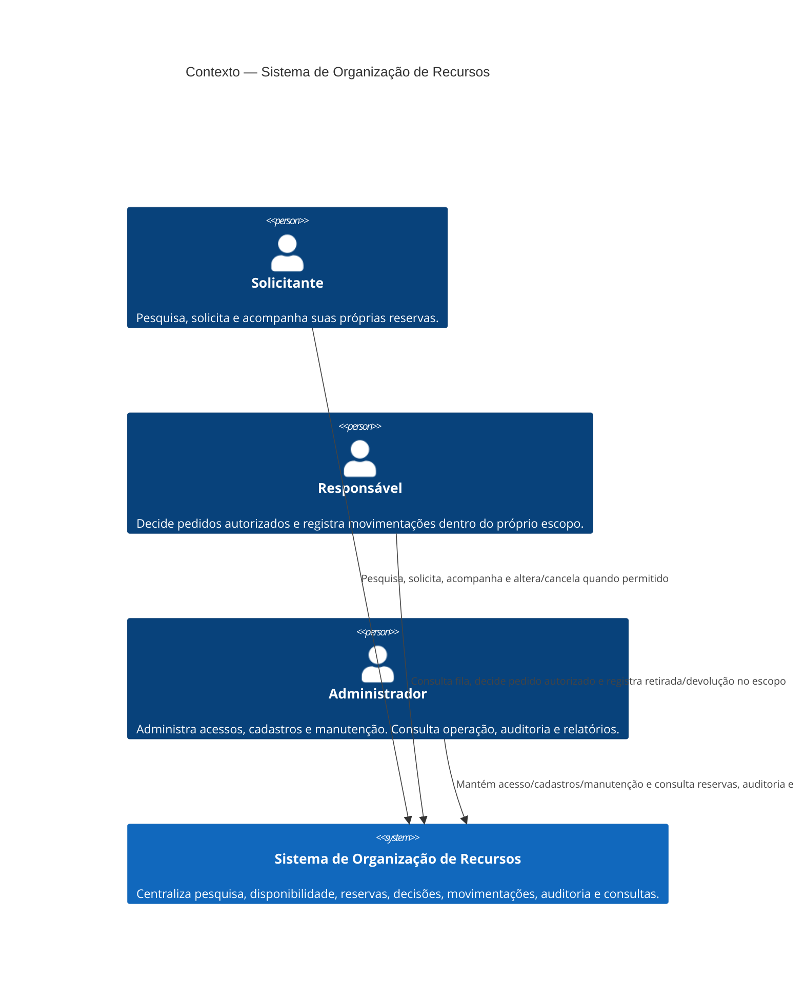

# C4 — Nível 1: Contexto do Sistema

**Objetivo:** situar as três personas e o limite do Sistema de Organização de Recursos.
**Limite:** apresenta o sistema como unidade; não detalha processo, armazenamento ou componentes.
**Status:** proposta revisada, não aprovada nem implementada. Sem sistema externo confirmado pelas fontes; notificações podem ser internas ou integradas após DP-009.

## Elementos e responsabilidades

| Elemento | Responsabilidade/limite |
|---|---|
| Solicitante | Ações autenticadas sobre consultas autorizadas e reservas próprias. |
| Responsável | Escopo atribuído pelo sistema; autorização é verificada no servidor para cada alvo e ação (DP-003). |
| Administrador | Operação administrativa sujeita às regras e auditoria; não recebe aprovação implícita de recurso restrito nem edição de auditoria. |
| Sistema | Fonte operacional para disponibilidade, estados, permissões, movimentações, auditoria e relatórios. |

## Integrações e limites externos

Nenhum provedor de identidade, sistema de agenda docente, serviço de notificação, canal institucional ou API pública foi confirmado. A comunicação exigida por RF-031..RF-033 não determina dependência externa: a arquitetura base pode apresentar atualizações dentro do sistema; eventual integração externa só será adicionada quando canal e contrato forem decididos (DP-009). A fonte de dados docente é pendente (DP-016). Não desenhar essas possibilidades como sistemas externos existentes.

**Requisitos relacionados:** RF-001..RF-036; RN-009, RN-010, RN-015..RN-024; RNF-001..RNF-003, RNF-008..RNF-012.
**Pendências:** DP-003, DP-009, DP-012, DP-016, DP-019.
