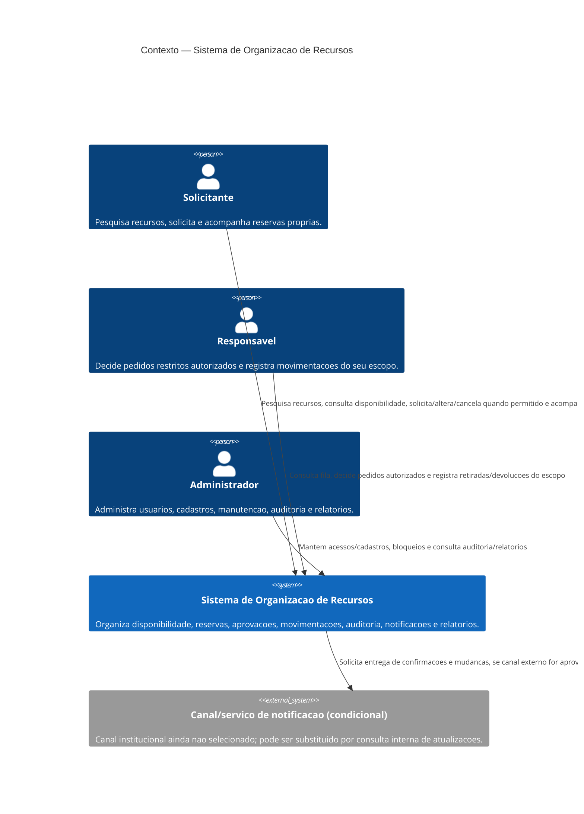

# C4 — Nivel 1: Contexto do Sistema

**Objetivo:** Mostrar usuarios, responsabilidade do Sistema de Organizacao de Recursos e dependencias externas confirmadas ou condicionais.  
**Limite:** O sistema inclui interface, aplicacao, regras e dados internos; nao detalha processo, armazenamento ou componentes neste nivel.  
**Status:** Proposta para revisao.

## Elementos e responsabilidades

| Elemento | Responsabilidade e relacao |
|---|---|
| Solicitante | Interage somente por operacoes autorizadas e reservas proprias. |
| Responsavel | Interage dentro do escopo atribuido, com decisao restrita somente quando autorizado. |
| Administrador | Interage com operacoes administrativas validadas e auditaveis; nao pode editar auditoria nem aprovar por privilegio implicito. |
| Sistema | Centraliza consulta e operacao de recursos, integridade de reservas, autorizacao, auditoria e resultados verificaveis. |
| Canal/servico de notificacao | Dependencia externa condicional. Canal e provedor estao pendentes (DP-009); nao e necessario para interpretar o resultado de negocio. |

## Trocas conceituais

Personas enviam criterios de consulta, dados de solicitacao/decisao e confirmacoes de operacao. O sistema retorna recursos/detalhes autorizados, disponibilidade e conflitos, estados de reserva, justificativas autorizadas, confirmacoes e relatorios. Ao canal externo, se aprovado, transmite conteudo minimo para destinatario autorizado; nenhuma fonte institucional de professor foi modelada porque DP-016 ainda nao confirma essa integracao.

## Justificativa e requisitos

Um unico sistema atende os tres perfis e mantem controles de autorizacao por caso de uso. A dependência de notificacao aparece condicionalmente porque o escopo exige comunicacoes, mas nao define provedor ou canal. Nao ha sistema externo de identidade ou fonte institucional confirmado; nao sao inventados.

**Requisitos relacionados:** RF-001..RF-036; RN-009, RN-010, RN-015, RN-016..RN-024; RNF-001..RNF-003, RNF-008..RNF-012.  
**Pendencias:** DP-003 (escopo), DP-009 (canal), DP-012 (contrato publico/API), DP-016 (fonte de dados docentes).