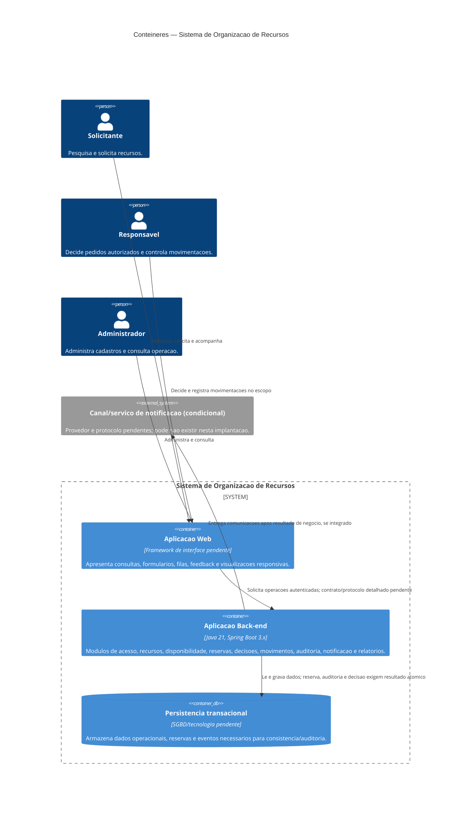

# C4 — Nivel 2: Conteineres

**Objetivo:** Mostrar unidades executaveis e armazenamento interno, responsabilidades, tecnologias definidas/pedentes e comunicacoes.  
**Limite:** Um contêiner C4 e processo/aplicacao/armazenamento, nao controller, service ou repository.  
**Status:** Proposta; escolha de contêiner de persistencia e UI permanece pendente.

## Conteineres

| Conteiner | Responsabilidade | Tecnologia/status | Relacionamentos/dados |
|---|---|---|---|
| Aplicacao Web | Interface por perfil, pesquisa, formularios, feedback e apresentacao de consultas/relatorios. Nao e autoridade para permissao ou regras. | Framework nao selecionado. | Personas -> Web -> Back-end; dados de entrada e resultados minimizados. |
| Aplicacao Back-end | Casos de uso, autorizacao, regras, transacoes, auditoria e coordenacao de adaptadores. | Java 21 e Spring Boot 3.x definidos como referencia. | Web -> Back-end; Back-end -> Persistencia; Back-end -> canal externo opcional. |
| Persistencia transacional | Preservar cadastro, disponibilidade, estado, movimentacao e auditoria com atomicidade necessaria. | Banco/engine/ORM pendentes (DP-017). | Leitura/escrita interna; nao e acesso direto de personas. |
| Canal externo | Entrega de avisos quando selecionado. | Provedor, protocolo e modo de falha pendentes (DP-009). | Back-end solicita entrega; falha nao desfaz negocio (RN-023). |

## Justificativa da forma de implantacao

Proposta de monolito modular: uma fronteira de transacao simplifica a invariante de nao aceitar sobreposicoes e registrar auditoria, reduz custo operacional da equipe academica e permite integrar persistencia real com Testcontainers. Dividir em microservicos criaria consistencia distribuida para reserva/auditoria sem requisito de escala independente. O monolito nao significa pacote unico: limites de modulo e contratos internos estao no nivel 3.

O armazenamento e representado por um unico contêiner lógico, sem escolher banco. A estrategia concreta de concorrencia depende de DP-001 (estados que ocupam) e DP-017 (capacidade/engine). A interface Web e o protocolo de chamada ainda nao foram escolhidos; nao se inventa REST/endpoint.

**Requisitos relacionados:** RF-001..RF-036; RN-001..RN-024; RNF-001..RNF-014, em especial RNF-004, 005, 008 e 011.  
**ADRs:** ADR-001, ADR-003, ADR-004, ADR-007.