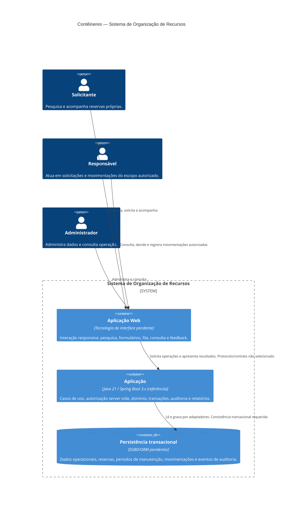

# C4 — Nível 2: Contêineres

**Objetivo:** mostrar unidades executáveis e o armazenamento lógico interno.
**Limite:** contêiner C4 é aplicação/processo/armazenamento; controllers, serviços e módulos lógicos são componentes de nível 3, não contêineres.
**Status:** proposta. Tecnologias não mandatórias permanecem em aberto.

## Contêineres e responsabilidades

| Contêiner | Limite e responsabilidade | Tecnologia/estado |
|---|---|---|
| Aplicação Web | Apresentação dos fluxos por perfil, entrada de critérios/dados e feedback; não decide autorização ou disponibilidade. | Framework, modo de sessão e protocolo em aberto. |
| Aplicação | Casos de uso, validações de domínio, autorização por ação/alvo, transações e coordenação dos componentes nível 3. | Java 21 e Spring Boot 3.x são a referência do escopo, ainda sem implementação. |
| Persistência transacional | Um limite lógico de consistência para reservas, bloqueios, movimentos e auditoria. | Recomendação inicial relacional; produto, versão, ORM e estratégia temporal aguardam DP-017. |

## Justificativa arquitetural e concorrência

Monólito modular é a forma inicial recomendada: reduz custo operacional e mantém reserva/auditoria na mesma fronteira transacional. Não há evidência de necessidade de escalabilidade independente que justifique microserviços; um único processo não implica módulo sem fronteiras. Ver ADR-001/002.

O armazenamento aparece como contêiner lógico, não decisão de banco. A criação, aprovação, alteração e manutenção devem compartilhar uma proteção atômica para os recursos/intervalos em disputa, revalidando o estado e registrando auditoria no mesmo resultado. Não basta consulta seguida de gravação. Alternativas e a corrida aprovação versus nova solicitação estão em ADR-004 e `uml/sequencia/CONCORRENCIA.md`; DP-001, DP-017 e DP-018 permanecem abertas.

## Integrações

Não há contêiner externo no desenho base porque as fontes não confirmam serviço de identidade, agenda docente, canal ou provedor de notificação. Comunicação é uma fronteira lógica interna; se DP-009 selecionar provedor, será um sistema externo condicional, chamado somente após confirmação do negócio. A falha de entrega não reverte reserva (RN-023). Não se pressupõe REST, mensageria nem acesso anônimo.

**Requisitos relacionados:** RF-001..RF-036; RN-001..RN-024; RNF-001..RNF-014.
**ADRs:** ADR-001, ADR-003, ADR-004, ADR-007.
**Pendências:** DP-001, DP-009, DP-012, DP-017..DP-019.
