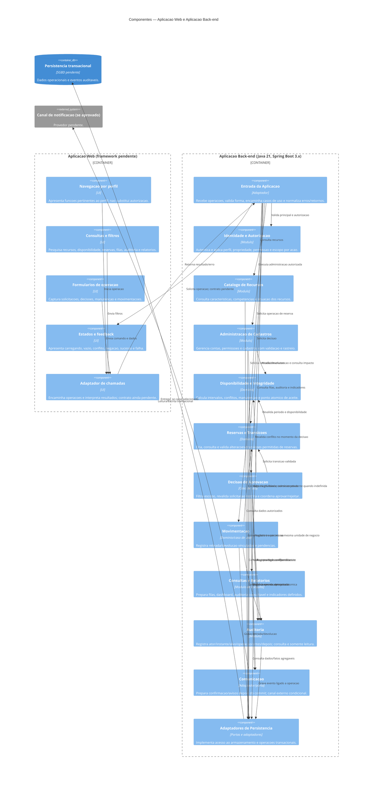

# C4 — Nivel 3: Componentes

**Objetivo:** Detalhar componentes conceituais dos contêineres Web e Back-end e suas responsabilidades/dependencias.  
**Limite:** Elementos sao componentes logicos no processo. Nao representam classes, pacotes fisicos, tabelas ou operacoes HTTP especificas.  
**Status:** Proposta para revisao.

## Dependencias e regras de organizacao

- `Entrada da Aplicacao` e o limite de entrada; identidade/permissao e reavaliada em toda operacao, inclusive leitura.
- `Reservas e Transicoes` e `Disponibilidade e Integridade` sao autoridade unica para invariantes temporais e ciclo de reserva. A interface e os demais modulos nao duplicam a regra de sobreposicao.
- `Decisao de Aprovacao` coordena a transicao em `Reservas e Transicoes`; nao altera diretamente estado persistido.
- `Movimentacao` registra fatos de custodia. Ela nao promove automaticamente reserva a `EM_USO` nem `CONCLUIDA` ate DP-006 ser decidida.
- `Auditoria` e chamada pela mesma operacao de negocio antes de confirmar; a consistencia atomica com a mudanca depende da persistencia escolhida (ADR-006).
- `Adaptadores de Persistencia` implementam contratos usados pelos casos de uso/dominio; componentes nao consultam estruturas internas de outros modulos.
- `Comunicacao` ocorre apos confirmacao de negocio. Falha nao reverte estado; durabilidade/reenvio requer escolha pendente (ADR-007).
- Dependencias entre modulos sao unidirecionais e por contrato. O diagrama nao obriga nomes de classes nem organizacao de pacotes.

**Requisitos relacionados:** RF-001..RF-036; RN-001..RN-024; RNF-001..RNF-014.  
**ADRs:** ADR-001, ADR-002, ADR-005, ADR-006, ADR-007, ADR-008 e ADR-009.  
**Pendencias:** DP-001, DP-003, DP-004, DP-006, DP-009, DP-011, DP-016, DP-017 e DP-018.