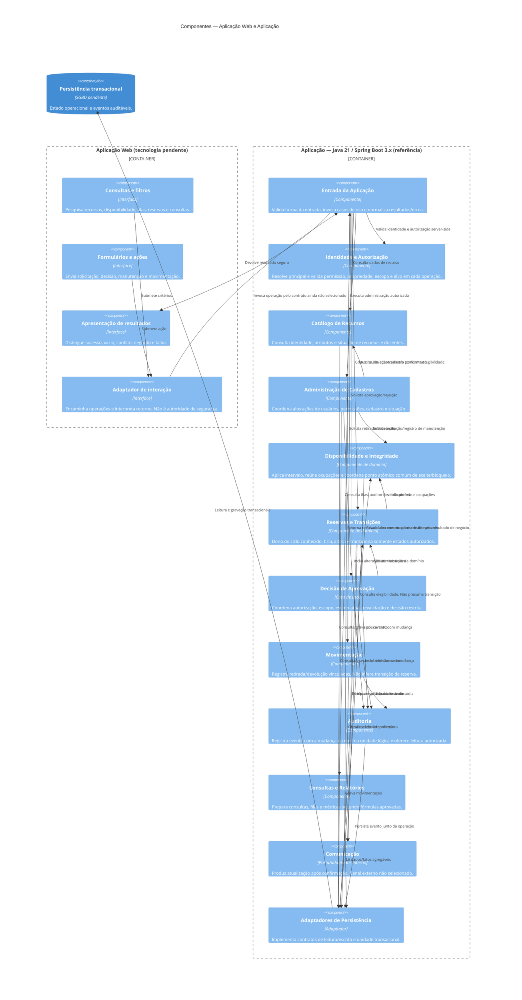

# C4 — Nível 3: Componentes

**Objetivo:** detalhar componentes lógicos dentro dos contêineres Web e Aplicação e seus contratos conceituais.
**Limite:** componentes não são processos, serviços implantáveis, classes, tabelas ou endpoints. Adaptadores de persistência acessam o contêiner de dados; os componentes de domínio não acessam diretamente seu esquema.
**Status:** proposta revisada; não implementada.

## Responsabilidades e dependências

- **Entrada da Aplicação** recebe operações; converte resultado de domínio para retorno seguro. Não substitui autorização e não acopla domínio a protocolo.
- **Identidade e Autorização** valida no servidor autenticação, perfil, permissão específica, propriedade e escopo para leitura ou escrita. Ocultar ação na Web é apenas UX. Matriz e provedor aguardam DP-003/DP-019.
- **Catálogo e Administração** tratam informações de recurso e alterações cadastrais; impactos existentes são consultados e não cancelados automaticamente (DP-005).
- **Disponibilidade e Integridade** é o único dono do predicado temporal e da orquestração do ponto efetivo de conflito. Atende solicitações, decisões, alterações e manutenção pelo mesmo mecanismo atômico; consultar antes não basta. A técnica concreta aguarda ADR-004/DP-017/018.
- **Reservas e Transições** é o único dono das transições persistidas e da elegibilidade; estados não especificados permanecem proibidos até decisão DP-006/007. Decisão de Aprovação não grava estado por acesso lateral.
- **Movimentação** mantém fato de retirada/devolução vinculado a reserva e recurso; sua persistência/auditoria pode ser atômica, mas não conclui reserva sem regra aprovada.
- **Auditoria** registra ator, instante, alvo, operação e antes/depois aplicáveis, com escrita inseparável da mudança crítica; a consulta é somente leitura e filtrada.
- **Consultas e Relatórios** lê apenas; falha não vira vazio/zero, e métrica sem definição/fonte não é calculada (DP-010).
- **Comunicação** é interna/abstrata, não implica sistema externo. Deve operar depois do commit e falha não desfaz negócio (DP-009).
- **Persistência** é adaptada por contratos internos. Um único armazenamento transacional é recomendado inicialmente; motor, ORM e garantias temporais aguardam DP-017.

## Coerência com demais níveis

Todos os componentes acima residem no único contêiner Aplicação do nível 2. Aplicação Web e Persistência transacional são contêineres; módulos de autenticação, reserva, disponibilidade, relatório, auditoria e comunicação são **componentes**, não contêineres. Não há integração externa assumida.
**Requisitos:** RF-001..RF-036; RN-001..RN-024; RNF-001..RNF-014.
**ADRs:** ADR-001, ADR-002, ADR-004..ADR-009.
**Pendências:** DP-001, DP-003..DP-011, DP-013..DP-019.
