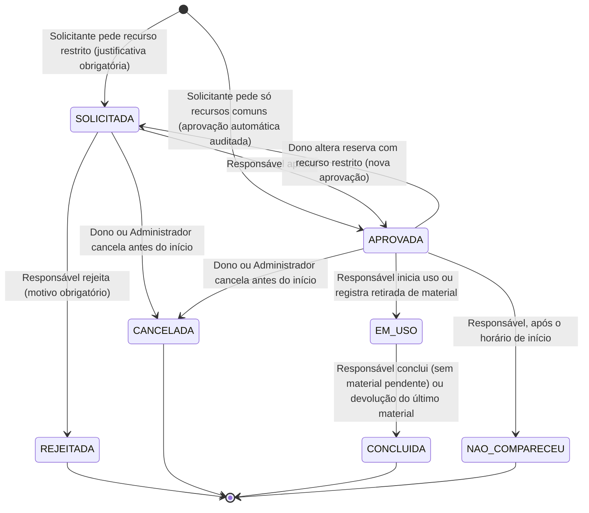

# UML — Ciclo de Estados da Reserva

**Objetivo:** documentar as transições implementadas, quem pode executá-las e o efeito de cada estado sobre a disponibilidade.
**Fontes:** RN-004, RN-011..RN-014, RN-025..RN-030; RF-009, RF-010, RF-013, RF-014, RF-016, RF-017, RF-019, RF-020; decisões DP-001, DP-006 e DP-007 (registro de 09/11/2026).
**Status:** modelo **implementado** em `br.edu.sor.reservas.EstadoReserva` e verificado por `EstadoReservaTest` (tabela completa de transições) e `CicloDeVidaReservaTest` (API).

## Estados e efeito sobre a disponibilidade

| Estado | Ocupa horário? | Observação |
|---|---|---|
| `SOLICITADA` | **Sim** (DP-001) | A disputa entre pedidos simultâneos é resolvida na criação. |
| `APROVADA` | Sim | Única origem possível de `EM_USO` e `NAO_COMPARECEU`. |
| `EM_USO` | Sim | Reserva iniciada: não pode ser cancelada nem apagada. |
| `CONCLUIDA` | Não | Libera o horário restante. |
| `REJEITADA` | Não | Terminal; não há reabertura. |
| `CANCELADA` | Não | Terminal; o registro e o histórico permanecem. |
| `NAO_COMPARECEU` | Não | Terminal; exigido pelo enunciado. |

## Regras transversais

- **Nenhuma reserva é apagada.** A API não oferece exclusão (`DELETE` responde 405); a correção de um pedido é feita por cancelamento ou alteração.
- **Toda transição gera auditoria** na mesma transação (estado anterior, novo, ator, instante) — ADR-006.
- **Transições concorrentes** sobre a mesma reserva são serializadas por `SELECT ... FOR UPDATE` na reserva: duas aprovações simultâneas resultam em uma aprovação e um 409 `TRANSICAO_INVALIDA`.
- Manutenção bloqueia novos usos (RN-007) e é recusada se houver reserva ativa no intervalo (RN-028).
- Retirada/devolução são fatos próprios (`movimentacao`), mas acionam as transições acima conforme RN-030.
