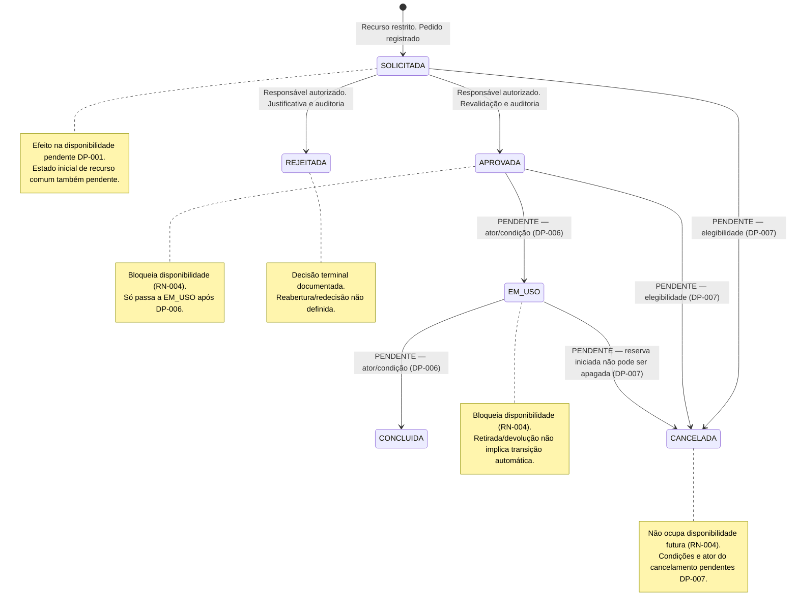

# UML — Ciclo de Estados da Reserva

**Objetivo:** distinguir transições já especificadas de estados/transições mencionados, porém sem regra suficiente para autorizá-los.
**Fontes:** RN-004, RN-011..RN-014; RF-009, RF-010, RF-016, RF-017, RF-019, RF-020; DP-001, DP-006, DP-007.
**Status:** modelo parcial para validação; não libera transição pendente.

## Estados e efeito sobre disponibilidade

| Estado | Conhecimento da regra | Efeito em nova disponibilidade | Observação |
|---|---|---|---|
| `SOLICITADA` | Estado conhecido; uso depende do fluxo | **Pendente DP-001** | Não presumir que bloqueia nem que não bloqueia. |
| `APROVADA` | Estado conhecido | Bloqueia intervalo coincidente (RN-004) | Qualquer nova confirmação revalida contra ela. |
| `EM_USO` | Estado conhecido | Bloqueia intervalo coincidente (RN-004) | Transição de entrada e saída aguardam DP-006. |
| `CONCLUIDA` | Estado conhecido | Não tratada como reserva futura ativa (RN-004) | Condições de conclusão ainda pendentes DP-006. |
| `REJEITADA` | Decisão especificada para `SOLICITADA` | Não bloqueia disponibilidade futura | Sem reabertura/redecisão definida. |
| `CANCELADA` | Estado conhecido; condições da transição pendentes | Não bloqueia disponibilidade futura | Cancelamento não apaga reserva/histórico. |

Manutenção também bloqueia novos usos no intervalo (RN-007). O destino de reserva previamente aceita que venha a coincidir com nova manutenção está pendente DP-004; nenhuma transição ou cancelamento implícito é mostrado. Uma movimentação de retirada/devolução é fato operacional separado do estado da reserva.

## Transições e autorização

| Transição/ação | Status | Ator e precondições conhecidas | Consistência/auditoria |
|---|---|---|---|
| Criar solicitação restrita → `SOLICITADA` | Especificada | Solicitante autenticado; solicitação válida; processo de recursos restritos | Criação e evento de estado devem ser confirmados juntos (RF-030/RN-016). |
| Recurso comum → estado inicial | Pendente | Estado inicial imediato ou `SOLICITADA` não definido nas fontes | Não assumir aceite imediato. |
| `SOLICITADA` → `APROVADA` | Especificada | Responsável **autorizado para solicitação e recurso**, dentro do escopo; estado ainda pendente; disponibilidade/docente/manutenção revalidados | Um único ponto atômico para revalidar, transicionar e auditar. |
| `SOLICITADA` → `REJEITADA` | Especificada | Responsável autorizado; justificativa conforme critérios ainda pendentes DP-002 | Estado, justificativa e evento confirmados coerentemente. |
| `APROVADA` → `EM_USO` | Pendente (DP-006) | Ator, evento de início e elegibilidade não definidos | Não inferir da retirada. |
| `EM_USO` → `CONCLUIDA` | Pendente (DP-006) | Ator e relação com devolução/fim da atividade não definidos | Não inferir da devolução. |
| Estado elegível → `CANCELADA` | Pendente (DP-007) | Solicitante pode pedir cancelamento próprio; estados elegíveis, prazo, justificativa e ator da efetivação pendentes | Sem exclusão; se autorizada, auditoria do estado anterior/novo. |
| Rejeitada/cancelada → outro estado | Não especificada | Nenhum ator/transição autorizado nas fontes | Não reabrir nem repetir efeito por inferência. |
| Excluir reserva iniciada | Proibida | Nenhum ator | Preservar reserva e trilha; não substituir por exclusão física. |

## Transições inválidas no modelo atual

- Autoaprovação do Solicitante ou decisão por Responsável fora do escopo/permissão.
- Aprovação/rejeição de estado já resolvido, ou aprovação sem revalidar disponibilidade, professor, recurso e manutenção.
- Inferir `APROVADA → EM_USO` de retirada, ou `EM_USO → CONCLUIDA` de devolução.
- Cancelar/apagar reserva iniciada, ou editar/excluir evento de auditoria.
- Confirmar dois aceites conflitantes para o mesmo recurso/intervalo.

**Integridade:** transição, auditoria e alteração de disponibilidade devem confirmar como uma unidade lógica. Métodos físicos e a corrida aprovação versus nova solicitação estão em ADR-004 e `sequencia/CONCORRENCIA.md`; testar todas as transições apenas depois de DP-001, DP-006 e DP-007 serem decididas.
