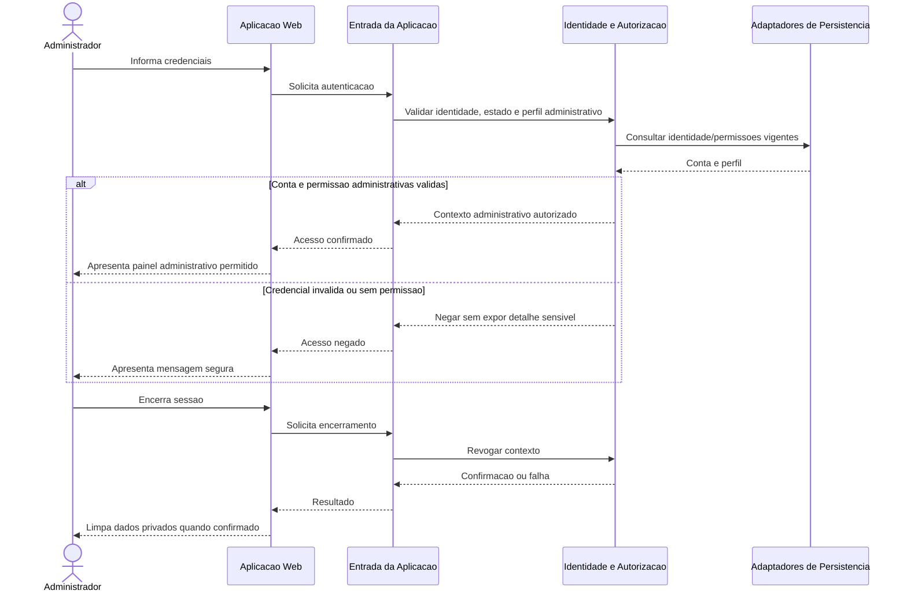
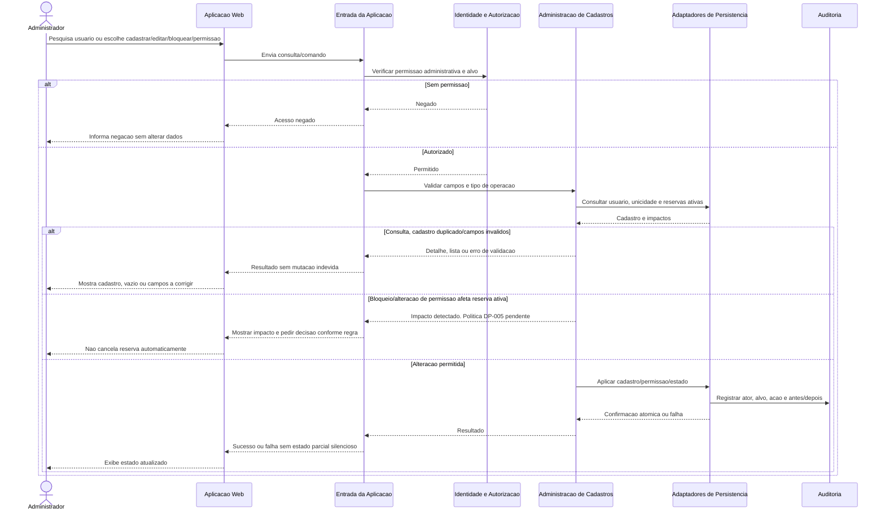
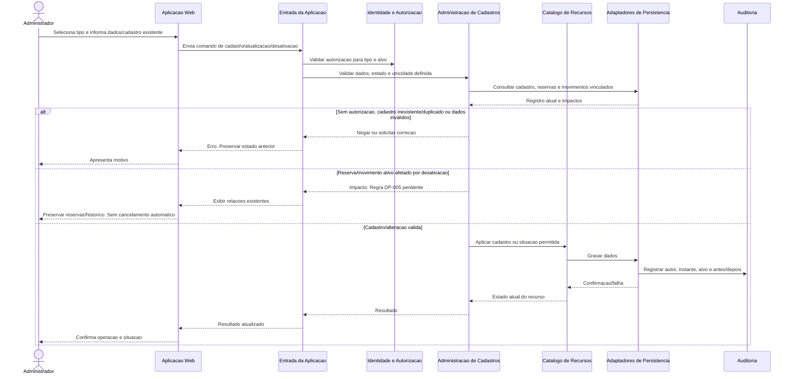
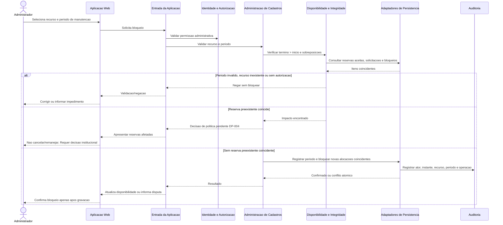
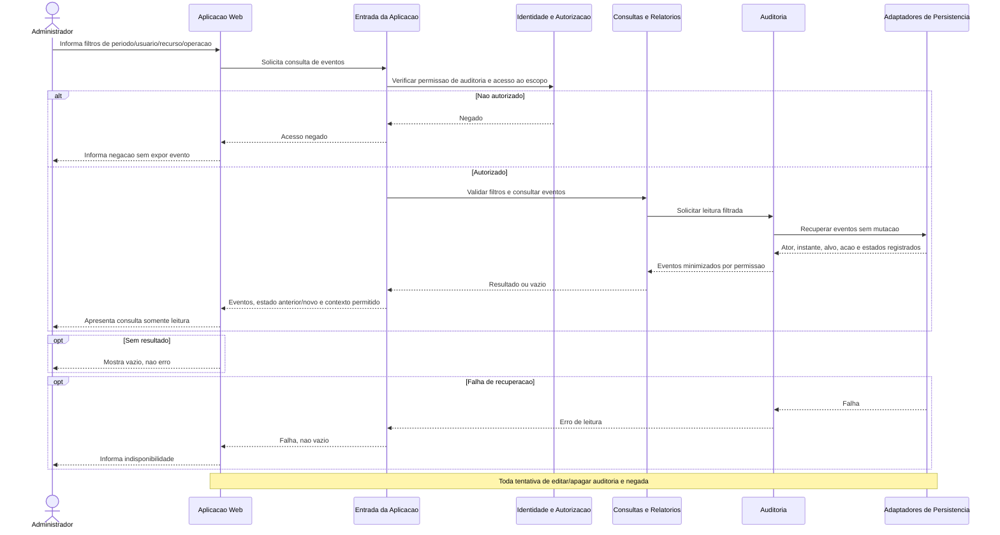
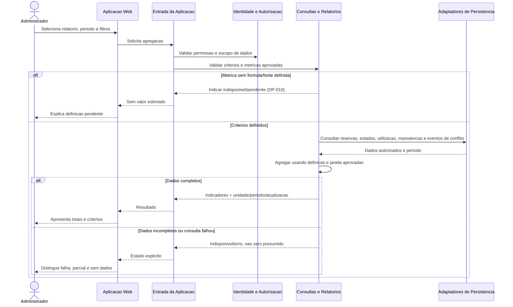

# UML de Sequencia — Administrador

Participantes refletem componentes de [C4 nivel 3](../../c4/NIVEL_3_COMPONENTES.md). O privilegio administrativo nao substitui regra de negocio ou auditoria; administrador nao recebe aprovacao implicita de recurso restrito.

## SEQ-ADM-001 — Autenticacao administrativa

**Objetivo:** autenticar a administradora e validar permissoes administrativas (J-ADM-001/RF-001/RF-002/RNF-001).  
**Limite:** autenticacao e autorizacao sao verificadas no servidor; provedor de identidade pendente DP-019.

**Responsabilidades:** Web apresenta entrada/painel; Entrada coordena; Identidade e Autorizacao verifica perfil/permissoes; persistencia fornece identidade e atribuicoes. A sessao/provedor final depende de DP-019.  
**Requisitos:** RF-001..RF-003; RN-015, RN-022; RNF-001..RNF-003.

## SEQ-ADM-002 — Gerenciamento de usuarios

**Objetivo:** cadastrar, consultar, editar, bloquear/desbloquear e alterar permissoes com controle e trilha (J-ADM-003/RF-022).  
**Limite:** matriz fina, unicidade e impacto em reservas ativas dependem DP-003/DP-005.

**Requisitos:** RF-002, RF-022, RF-030; RN-015, RN-017, RN-022; RNF-001..RNF-005, RNF-011. Auditoria de alteracao e leitura de reservas ativas sao obrigatorias; bloqueio nao cancela reserva implicitamente.

## SEQ-ADM-003 — Cadastro e atualizacao de recursos

**Objetivo:** cadastrar/atualizar salas, professores, materiais e equipamentos preservando integridade (J-ADM-004..J-ADM-006/RF-023..RF-025).  
**Limite:** fluxo comum de validacao e impacto; atributos por tipo dependem da politica institucional.

**Dados/validacoes:** tipo, identificacao, capacidade/localizacao para sala, competencias/situacao docente, caracteristicas/situacao de itens, reservas/manutencoes/movimentos relacionados. **Requisitos:** RF-002, RF-004, RF-005, RF-023..RF-025, RF-030; RN-003, RN-007, RN-008, RN-017, RN-022; RNF-001..RNF-005, RNF-011.

## SEQ-ADM-004 — Bloqueio de manutencao

**Objetivo:** registrar periodo de manutencao, identificar reservas coincidentes e impedir novas reservas conflitantes (J-ADM-007/RF-026).  
**Limite:** nenhuma reserva existente e cancelada ou remanejada automaticamente; solucao de impacto depende DP-004.

**Concorrencia:** bloqueio e confirmacao de reserva disputam a mesma disponibilidade; a operacao que confirmar primeiro e respeitada, e a seguinte deve revalidar. Nunca aceitar reserva conflitante apos bloqueio efetivado. **Requisitos:** RF-006..RF-008, RF-026, RF-030; RN-001, RN-002, RN-005, RN-007, RN-016, RN-017; RNF-004, RNF-005, RNF-011.

## SEQ-ADM-005 — Consulta de auditoria

**Objetivo:** pesquisar eventos por periodo, usuario, recurso/acao e apresentar dados autorizados sem mutar registro (J-ADM-008/RF-029).  
**Limite:** consulta somente leitura; nem Administrador pode editar/apagar eventos.

**Requisitos:** RF-002, RF-012, RF-029..RF-030; RN-015..RN-018, RN-022; RNF-001..RNF-003, RNF-011..RNF-012. Retencao e escopo de campos dependem DP-011.

## SEQ-ADM-006 — Geracao de relatorios

**Objetivo:** obter indicadores por recurso e periodo com criterios explicitos (J-ADM-002/J-ADM-009; RF-028/RF-034..RF-036).  
**Limite:** consulta nao altera reservas; nenhuma formula ausente e estimada.

**Requisitos:** RF-002, RF-027..RF-028, RF-034..RF-036; RN-004, RN-007, RN-012, RN-024; RNF-001..RNF-003, RNF-006, RNF-008..RNF-009, RNF-012.  
**Pendencias:** metricas, fonte de conflitos evitados, periodo e estados incluidos (DP-010); metas de desempenho (DP-014).