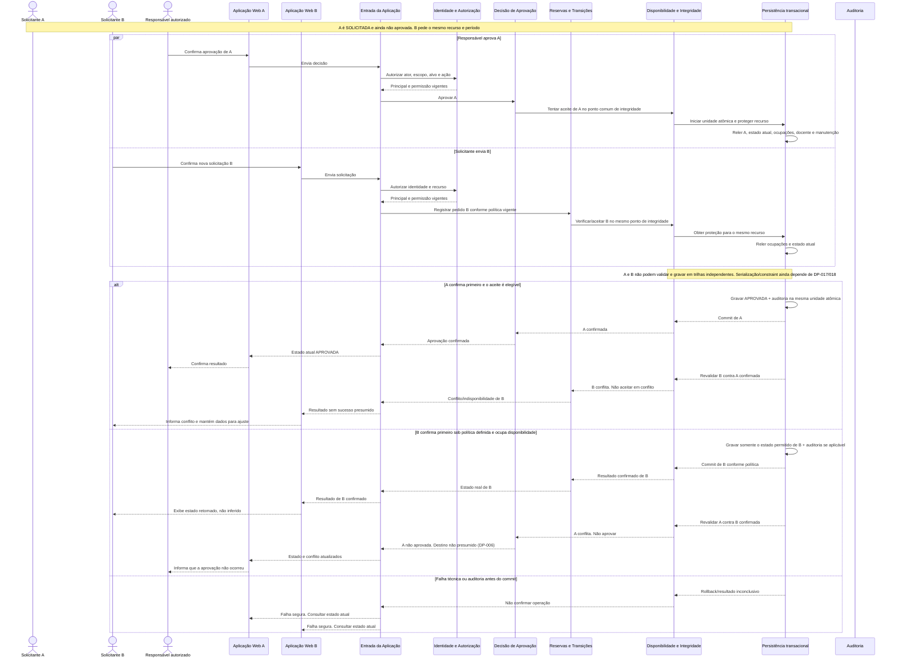

# UML de Sequência — Concorrência de Reservas

## SEQ-CRIT-001 — Aprovação concorrente com nova solicitação

**Objetivo:** documentar a disputa entre uma solicitação restrita pendente A e uma nova solicitação B para o mesmo recurso/período; nenhum par conflitante pode resultar aceito.
**Base:** J-SOL-004, J-RES-003, J-ADM-007; RF-006..RF-009, RF-016, RF-026, RF-030; RN-001..RN-007, RN-011, RN-016; RNF-004/005/007/011.
**Status:** comportamento arquitetural proposto; banco/mecanismo não selecionados. `SOLICITADA` e estado inicial de recurso comum seguem DP-001. O diagrama não decide qual pedido ganha em termos de negócio.

## Invariante

Para intervalos semiabertos `[início, fim)`, conflito é `inícioA < fimB E inícioB < fimA`; intervalos adjacentes não conflitam. Para qualquer par de alocações aceitas que bloqueiam disponibilidade para o mesmo recurso, não pode haver sobreposição. `APROVADA` e `EM_USO` bloqueiam (RN-004); manutenção também bloqueia novos aceites coincidentes (RN-007). Efeito de `SOLICITADA` ainda não foi decidido. A regra de concorrência assegura exclusão entre aceites bloqueantes sem definir se pedidos pendentes reservam horário.

## Sequência de proteção requerida

Toda criação/aceite, aprovação, alteração de alocação e inclusão de manutenção que concorra pelo mesmo recurso deve:

1. atravessar o mesmo ponto de integridade;
2. validar autorização, versão/estado atual e período;
3. obter proteção transacional pelo recurso (para múltiplos recursos, ordem determinística);
4. reconsultar os ocupantes, manutenção, cadastro e agenda docente relevante dentro da seção protegida;
5. efetivar mudança e auditoria juntas ou falhar sem anunciar sucesso;
6. converter disputa perdida em conflito de negócio; não expor exceções internas.

**Pré-consulta:** útil para UX, mas não adquire o direito de reservar nem elimina a revalidação no instante da gravação.

## Variações de ordem e questões pendentes

- **Duas novas solicitações simultâneas:** ambas devem passar pelo mesmo ponto protegido. Se a política aprovada resultar em duas aceitações bloqueantes para períodos sobrepostos, somente uma pode confirmar; a segunda relê o vencedor e recebe conflito. Se a política produzir solicitações `SOLICITADA` não bloqueantes, a concorrência entre pendências e a decisão final continuam sujeitas a DP-001, e nenhuma dupla aprovação futura pode contornar a proteção.
- **Aprovação A vence:** commit `SOLICITADA → APROVADA` + auditoria; B revalida e é impedida se conflitante.
- **B vence:** somente se a política do pedido B resultar em estado que bloqueie disponibilidade; aprovação A revalida e não é aceita. O estado final de A se perder disponibilidade permanece DP-006.
- **DP-001: `SOLICITADA` bloqueia?** Se sim, B pode ser impedida enquanto A aguarda, retendo horário; se não, B ainda pode disputar o aceite final. Nenhuma alternativa é selecionada.
- **Manutenção versus aprovação/reserva:** mesma proteção; após manutenção efetivada, novos usos conflitantes são impedidos. Compromisso pré-existente não é cancelado/remanejado; política DP-004.
- **Vários recursos:** atomicidade tudo-ou-nada versus parcial pendente DP-013; locks, se usados, ordenados deterministicamente para reduzir deadlock.
- **Falha/retry:** estado de retorno deve ser distinguível de conflito e sucesso; repetição segura/idempotência e reconciliação de operação inconclusiva precisam ser definidas na seleção técnica (DP-014/017/018).

## Alternativas de mecanismo

| Alternativa | Benefícios | Limitações e riscos | Evidência futura |
|---|---|---|---|
| Bloqueio transacional por recurso | Ordena disputa e permite revalidar perto do commit | Dependente do motor; contenção, timeout e deadlock com vários recursos; mutex de processo não serve | Corridas reais com transações em Testcontainers e mesma chave de recurso |
| Restrição temporal/exclusion do SGBD | Defesa no limite do armazenamento; dificulta bypass por outra escrita | Suporte/modelagem variam; estados bloqueantes e exceções devem estar representados | Testar constraint, adjacência e mapeamento de conflito por SGBD real |
| Serializável/controle otimista e conflito/retry | Detecta atualização concorrente; paralelismo para períodos independentes conforme motor | Abortos, política de retry/idempotência e custo sob carga | Teste de concorrência e carga no motor escolhido |
| Consulta e gravação sem guarda atômica | Nenhum benefício que compense | Rejeitada: aceita race condition e viola RF-008 | Não aplicável |

O mecanismo físico é decisão técnica posterior, não uma regra de negócio. ADR-004 contém a proposta e os critérios de decisão; ADR-003 registra a dependência do SGBD. Nenhuma evidência acima foi executada.
