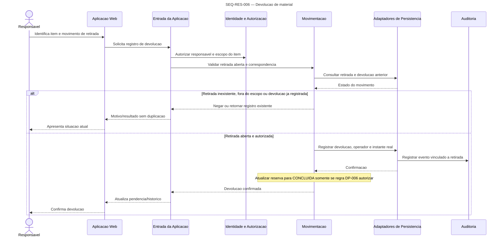

# UML de Sequencia — Responsavel

Participantes correspondem aos componentes de [C4 nivel 3](../../c4/NIVEL_3_COMPONENTES.md). O escopo do responsavel e validado no servidor em cada operacao; nao ha acesso global implicito. Transicoes de uso nao definidas em DP-006 permanecem fora dos fluxos confirmados.

## SEQ-RES-001 — Consulta de solicitacoes pendentes

**Objetivo:** listar/filtrar pedidos do escopo e fornecer contexto para decisao (J-RES-001/002/008; RF-002/RF-015).  
**Limite:** leitura; nao altera estado nem concede acoes de decisao por si so.

```mermaid
sequenceDiagram
    title SEQ-RES-001 — Consulta de solicitacoes pendentes
    actor Res as Responsavel
    participant Web as Aplicacao Web
    participant Entrada as Entrada da Aplicacao
    participant Auth as Identidade e Autorizacao
    participant Relatorios as Consultas e Relatorios
    participant Disp as Disponibilidade e Integridade
    participant Persistencia as Adaptadores de Persistencia

    Res->>Web: Abre fila e informa filtros estado/recurso/periodo
    Web->>Entrada: Solicita pendencias
    Entrada->>Auth: Verificar identidade, escopo e leitura
    alt Sem escopo/permissao
        Auth-->>Entrada: Negado
        Entrada-->>Web: Acesso negado
        Web-->>Res: Informa acesso/escopo nao autorizado
    else Autorizado
        Auth-->>Entrada: Escopo autorizado
        Entrada->>Relatorios: Consultar pendencias no escopo
        Relatorios->>Persistencia: Ler solicitacoes, estados e recursos do escopo
        Persistencia-->>Relatorios: Resultados
        Relatorios->>Disp: Obter conflitos/manutencoes atuais para os periodos
        Disp->>Persistencia: Ler ocupacao e manutencao
        Persistencia-->>Disp: Estado atual
        Disp-->>Relatorios: Indicadores de conflito/indisponibilidade
        Relatorios-->>Entrada: Fila e detalhe com dados minimizados
        Entrada-->>Web: Resultado atualizado
        Web-->>Res: Apresenta solicitante, recurso, periodo, justificativa e estado
    end
    opt Nenhum resultado
        Relatorios-->>Entrada: Sem correspondencia
        Entrada-->>Web: Lista vazia
        Web-->>Res: Distingue vazio de erro
    end
    opt Falha de recuperacao
        Persistencia-->>Relatorios: Falha
        Relatorios-->>Entrada: Erro de consulta
        Entrada-->>Web: Falha
        Web-->>Res: Preserva filtros; nao apresenta fila vazia como resultado
    end
```

**Requisitos:** RF-002, RF-005, RF-015, RF-021; RN-010, RN-011, RN-015; RNF-001..RNF-003, RNF-006, RNF-009. **Dados:** filtros, principal, escopo, solicitacao, solicitante e conflito autorizado.

## SEQ-RES-002 — Aprovacao de reserva restrita

**Objetivo:** aprovar uma solicitacao elegivel com revalidacao atomica de disponibilidade e auditoria (J-RES-003; RF-016).  
**Limite:** somente decisor autorizado, estado ainda `SOLICITADA`, recurso restrito; colisao durante espera nao gera aceite duplo.

```mermaid
sequenceDiagram
    title SEQ-RES-002 — Aprovacao de reserva restrita
    actor Res as Responsavel
    actor Sol as Solicitante (destinatario)
    participant Web as Aplicacao Web
    participant Entrada as Entrada da Aplicacao
    participant Auth as Identidade e Autorizacao
    participant Decisao as Decisao de Aprovacao
    participant Disp as Disponibilidade e Integridade
    participant Reservas as Reservas e Transicoes
    participant Persistencia as Adaptadores de Persistencia
    participant Auditoria as Auditoria
    participant Comunicacao as Comunicacao

    Res->>Web: Abre pedido e seleciona aprovar
    Web->>Entrada: Envia decisao
    Entrada->>Auth: Autorizar ator, escopo e solicitacao
    Auth-->>Entrada: Autorizado ou negado
    Entrada->>Decisao: Solicita aprovacao
    Decisao->>Reservas: Ler estado atual
    Reservas->>Persistencia: Consultar solicitacao e estado
    Persistencia-->>Reservas: SOLICITADA ou estado atualizado
    Decisao->>Disp: Revalidar recurso, professor, manutencao e conflito
    Disp->>Persistencia: Ler ocupacao atual
    Persistencia-->>Disp: Reservas, bloqueios e alocacoes vigentes
    alt Sem permissao, nao restrita ou nao esta SOLICITADA
        Decisao-->>Entrada: Negar decisao; estado intacto
        Entrada-->>Web: Acesso/estado atualizado
        Web-->>Res: Explica impedimento
    else Conflito ou manutencao apareceu durante espera
        Disp-->>Decisao: Indisponivel
        Decisao-->>Entrada: Nao aprovar; destino da solicitacao depende DP-006
        Entrada-->>Web: Conflito atual
        Web-->>Res: Informa que pedido nao foi aprovado
        Web-->>Sol: Informa indisponibilidade conforme politica de comunicacao
    else Elegivel no ponto de decisao
        Disp-->>Decisao: Elegivel
        Decisao->>Reservas: Aplicar transicao solicitada
        Reservas->>Persistencia: Efetivar APROVADA com verificacao atomica
        Persistencia->>Auditoria: Registrar ator/instante/alvo/operacao/anterior/novo
        alt Transacao confirmada e sem disputa concorrente
            Persistencia-->>Reservas: APROVADA confirmada
            Reservas-->>Decisao: Resultado confirmado
            Decisao-->>Entrada: Aprovacao
            Entrada-->>Web: Estado atualizado
            Web-->>Res: Confirma decisao
            Decisao->>Comunicacao: Solicita aviso pos-confirmacao
            Comunicacao-->>Sol: Aprovacao ou falha de entrega separada
        else Outra reserva venceu a disputa ou auditoria/transacao falhou
            Persistencia-->>Reservas: Sem aceite/rollback atomico
            Reservas-->>Decisao: Conflito ou falha
            Decisao-->>Entrada: Nao aprovado
            Entrada-->>Web: Estado atual + motivo
            Web-->>Res: Informa conflito/falha
        end
    end
```

**Requisitos:** RF-002, RF-006..RF-008, RF-010, RF-015..RF-016, RF-030, RF-032..RF-033; RN-001..RN-012, RN-016, RN-023; RNF-001, RNF-003..RNF-005, RNF-008, RNF-011. **Auditoria:** transicao e evento devem confirmar na mesma unidade atomica. **Pendencia:** efeito de `SOLICITADA` na ocupacao (DP-001) e destino apos recurso indisponivel (DP-006).

## SEQ-RES-003 — Rejeicao de solicitacao

**Objetivo:** registrar rejeicao autorizada com justificativa e informar o solicitante (J-RES-004; RF-017).  
**Limite:** decisao valida somente se a solicitacao ainda estiver `SOLICITADA` e no escopo.

```mermaid
sequenceDiagram
    title SEQ-RES-003 — Rejeicao de solicitacao
    actor Res as Responsavel
    actor Sol as Solicitante
    participant Web as Aplicacao Web
    participant Entrada as Entrada da Aplicacao
    participant Auth as Identidade e Autorizacao
    participant Decisao as Decisao de Aprovacao
    participant Reservas as Reservas e Transicoes
    participant Persistencia as Adaptadores de Persistencia
    participant Auditoria as Auditoria
    participant Comunicacao as Comunicacao

    Res->>Web: Informa justificativa e confirma rejeicao
    Web->>Entrada: Envia decisao e motivo
    Entrada->>Auth: Validar responsavel/escopo
    Auth-->>Entrada: Permissao
    Entrada->>Decisao: Solicita rejeicao
    Decisao->>Reservas: Verificar estado mais recente
    Reservas->>Persistencia: Consultar estado da solicitacao
    Persistencia-->>Reservas: Estado atual
    alt Fora de escopo, estado resolvido ou justificativa invalida conforme regra
        Decisao-->>Entrada: Negar; nao alterar estado
        Entrada-->>Web: Motivo/estado atual
        Web-->>Res: Informa que rejeicao nao ocorreu
    else SOLICITADA e justificativa aceita
        Decisao->>Reservas: Transicionar para REJEITADA
        Reservas->>Persistencia: Gravar estado e justificativa
        Persistencia->>Auditoria: Gravar autor/instante/alvo/operacao/anterior/novo
        Persistencia-->>Reservas: Confirmacao atomica
        Reservas-->>Decisao: REJEITADA
        Decisao-->>Entrada: Decisao confirmada
        Entrada-->>Web: Atualiza fila
        Web-->>Res: Confirma rejeicao
        Decisao->>Comunicacao: Solicita aviso pos-confirmacao
        Comunicacao-->>Sol: Estado e motivo autorizado; falha nao reverte decisao
    end
```

**Requisitos:** RF-002, RF-017, RF-030, RF-032..RF-033; RN-010..RN-012, RN-014, RN-016, RN-023; RNF-001..RNF-003, RNF-005, RNF-008, RNF-011. Criterios de justificativa detalhados dependem DP-002.

## SEQ-RES-004 — Validacao de alocacao de professores

**Objetivo:** consultar agenda, encontrar sobreposicao e apoiar decisao sem expor dados docentes desnecessarios (J-RES-005/RF-018).  
**Limite:** consulta nao aprova nem bloqueia agenda; disponibilidade e revalidada em aprovacao.

```mermaid
sequenceDiagram
    title SEQ-RES-004 — Validacao de alocacao de professores
    actor Res as Responsavel
    participant Web as Aplicacao Web
    participant Entrada as Entrada da Aplicacao
    participant Auth as Identidade e Autorizacao
    participant Disp as Disponibilidade e Integridade
    participant Persistencia as Adaptadores de Persistencia

    Res->>Web: Seleciona professor e periodo
    Web->>Entrada: Solicita consulta de agenda
    Entrada->>Auth: Verificar escopo e acesso a disponibilidade
    alt Sem permissao
        Auth-->>Entrada: Negado
        Entrada-->>Web: Acesso negado
        Web-->>Res: Informa limite de escopo
    else Autorizado
        Auth-->>Entrada: Escopo permitido
        Entrada->>Disp: Validar intervalo e consultar alocacao
        Disp->>Persistencia: Ler alocacoes/periodos relevantes
        Persistencia-->>Disp: Alocacoes ou fonte ausente
        alt Periodo invalido
            Disp-->>Entrada: Erro temporal
            Entrada-->>Web: Validacao
            Web-->>Res: Solicita correcao
        else Alocacao sobreposta
            Disp-->>Entrada: Conflito docente
            Entrada-->>Web: Ocupado
            Web-->>Res: Mostra conflito; nao aprova
        else Agenda sem conflito conhecido
            Disp-->>Entrada: Sem sobreposicao na fonte consultada
            Entrada-->>Web: Resultado informativo
            Web-->>Res: Apresenta sem conflito conhecido
        else Agenda ausente/consulta falhou
            Disp-->>Entrada: Indisponibilidade de informacao
            Entrada-->>Web: Inconclusivo
            Web-->>Res: Nao indica professor como livre
        end
    end
```

**Requisitos:** RF-002, RF-006, RF-007, RF-018; RN-001..RN-003, RN-010, RN-015; RNF-001..RNF-004, RNF-009. Fonte/completude docente pendente DP-016.

## SEQ-RES-005 — Retirada de material

**Objetivo:** registrar retirada autorizada e identificar operador, recebedor e instante (J-RES-006/RF-019).  
**Limite:** retirada nao implica por si so transicao para `EM_USO` (DP-006).

```mermaid
sequenceDiagram
    title SEQ-RES-005 — Retirada de material
    actor Res as Responsavel
    actor Recebedor as Pessoa que recebe
    participant Web as Aplicacao Web
    participant Entrada as Entrada da Aplicacao
    participant Auth as Identidade e Autorizacao
    participant Movimento as Movimentacao
    participant Persistencia as Adaptadores de Persistencia
    participant Auditoria as Auditoria

    Res->>Web: Identifica reserva, recurso e recebedor
    Web->>Entrada: Solicita registro de retirada
    Entrada->>Auth: Autorizar responsavel e recurso no escopo
    Auth-->>Entrada: Autorizacao
    Entrada->>Movimento: Validar reserva/recurso/estado e duplicidade
    Movimento->>Persistencia: Consultar reserva e retirada existente
    Persistencia-->>Movimento: Estado e vinculos
    alt Sem autorizacao, sem reserva elegivel ou retirada ja registrada
        Movimento-->>Entrada: Negar ou retornar movimento existente
        Entrada-->>Web: Motivo/resultado idempotente
        Web-->>Res: Informa resultado sem liberar movimento indevido
    else Elegivel
        Movimento->>Persistencia: Registrar operador, recebedor, recurso e instante real
        Persistencia->>Auditoria: Registrar movimento e ator/instante/alvo
        Persistencia-->>Movimento: Registro confirmado
        Movimento-->>Entrada: Retirada registrada; estado da reserva inalterado se transicao nao definida
        Entrada-->>Web: Confirmacao
        Web-->>Res: Exibe movimento no historico
        Web-->>Recebedor: Apresenta confirmacao do recebimento conforme processo
    end
```

**Requisitos:** RF-002, RF-019, RF-021, RF-030; RN-010, RN-016, RN-020; RNF-001, RNF-003, RNF-005, RNF-011. Elegibilidade e terceiro retirante pendem DP-008.

## SEQ-RES-006 — Devolucao de material

**Objetivo:** vincular devolucao a retirada aberta, identificar operador e instante e encerrar pendencia de movimentacao (J-RES-007/RF-020/RF-021).  
**Limite:** transicao `EM_USO` -> `CONCLUIDA` nao e inferida pela devolucao; depende DP-006.



**Requisitos:** RF-002, RF-020, RF-021, RF-030; RN-010, RN-016, RN-021; RNF-001, RNF-003, RNF-005, RNF-011. Avaria/atraso pendem DP-008.

## SEQ-RES-007 — Consulta de pendencias

**Objetivo:** listar solicitacoes aguardando decisao e retiradas sem devolucao no escopo do responsavel (J-RES-008/RF-015/RF-021).  
**Limite:** pendencia sem prazo nao deve ser rotulada como atraso.

```mermaid
sequenceDiagram
    title SEQ-RES-007 — Consulta de pendencias
    actor Res as Responsavel
    participant Web as Aplicacao Web
    participant Entrada as Entrada da Aplicacao
    participant Auth as Identidade e Autorizacao
    participant Relatorios as Consultas e Relatorios
    participant Persistencia as Adaptadores de Persistencia

    Res->>Web: Abre pendencias e informa filtros
    Web->>Entrada: Solicita fila do escopo
    Entrada->>Auth: Validar principal e escopo
    Auth-->>Entrada: Escopo ou negacao
    Entrada->>Relatorios: Consultar solicitacoes pendentes e movimentos abertos
    Relatorios->>Persistencia: Ler estados e retiradas/devolucoes
    Persistencia-->>Relatorios: Registros autorizados
    Relatorios->>Relatorios: Classificar pendencias; atraso somente com prazo definido
    alt Ha itens
        Relatorios-->>Entrada: Fila agrupada por tipo e estado
        Entrada-->>Web: Resultado atual
        Web-->>Res: Apresenta item, periodo, responsavel e proxima acao
    else Sem itens
        Relatorios-->>Entrada: Lista vazia
        Entrada-->>Web: Sem pendencias
        Web-->>Res: Estado vazio
    end
    opt Prazo de devolucao nao definido
        Relatorios-->>Web: Nao classificar item como atrasado
    end
    opt Falha de leitura
        Persistencia-->>Relatorios: Falha
        Relatorios-->>Entrada: Erro
        Entrada-->>Web: Falha, nao lista vazia
        Web-->>Res: Mantem filtros e oferece nova tentativa
    end
```

**Requisitos:** RF-002, RF-015, RF-021, RF-029; RN-010, RN-015, RN-020, RN-021; RNF-001..RNF-003, RNF-006, RNF-009, RNF-011.  
**Rastreabilidade:** IDs de testes, resultados, componentes aprovados e evidencias executadas permanecem pendentes.

## Pendencias que afetam estas sequencias

DP-003 define escopo/atribuicao; DP-006 define transicoes durante uso e perda de disponibilidade; DP-008 define elegibilidade, terceiros, prazos e avarias; DP-009 define canal/entrega. Ate decisao, os diagramas mostram a fronteira de validacao e deixam os ramos de negocio em aberto.