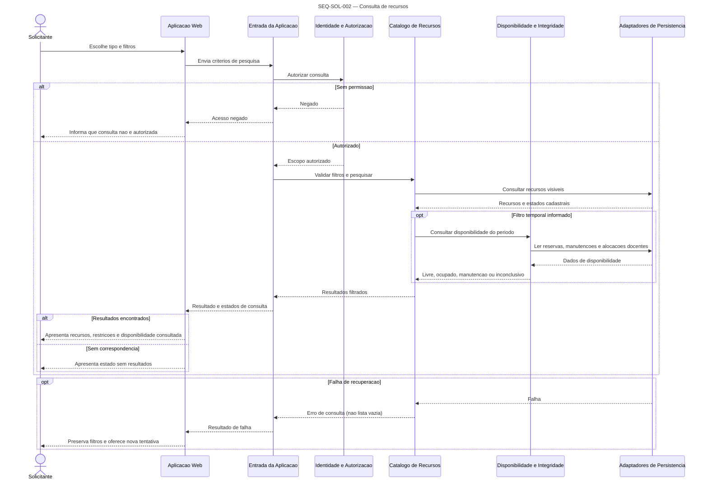
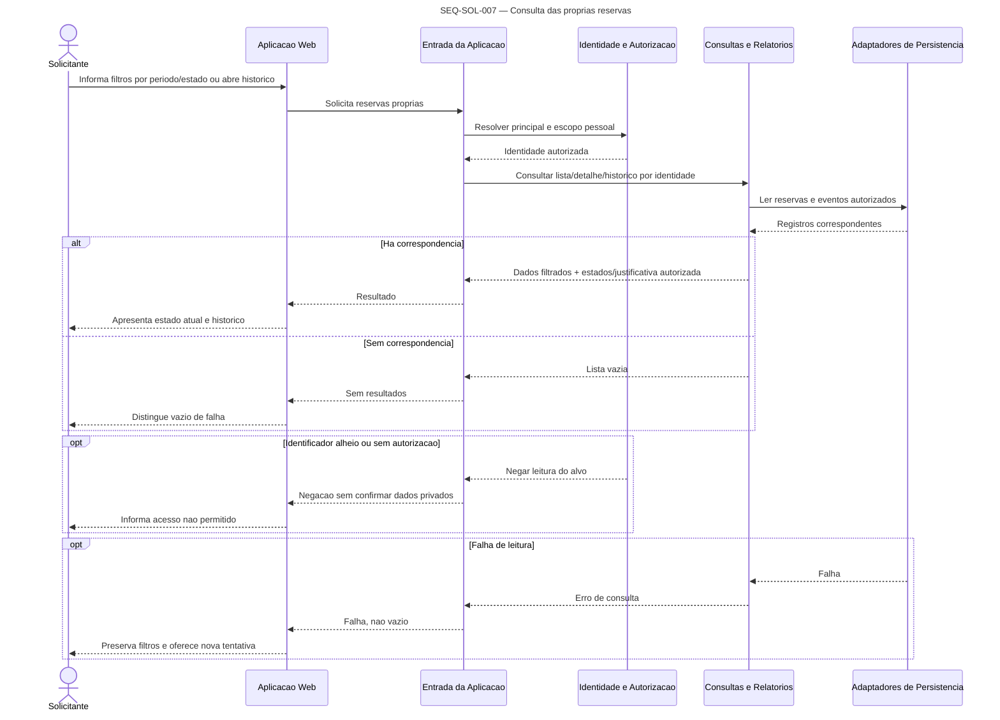

# UML de Sequencia — Solicitante

Participantes sao componentes conceituais definidos em `../../c4/NIVEL_3_COMPONENTES.md`; os diagramas nao definem endpoints nem contrato de interface. Falhas e ramos condicionais fazem parte do comportamento, nao de uma tecnologia.

## SEQ-SOL-001 — Autenticacao

**Objetivo:** validar credenciais, resolver perfil e iniciar acesso permitido, conforme J-SOL-001/RF-001..RF-003/RNF-001..RNF-003.  
**Limite:** fluxo da interface ate o contexto autorizado; provedor de identidade nao selecionado (DP-019).

```mermaid
sequenceDiagram
    title SEQ-SOL-001 — Autenticacao
    actor Sol as Solicitante
    participant Web as Aplicacao Web
    participant Entrada as Entrada da Aplicacao
    participant Auth as Identidade e Autorizacao
    participant Persistencia as Adaptadores de Persistencia

    Sol->>Web: Informa identificacao e credenciais
    Web->>Entrada: Solicita autenticacao
    Entrada->>Auth: Validar credencial e situacao da conta
    Auth->>Persistencia: Consultar identidade/perfil (fonte pendente)
    Persistencia-->>Auth: Resultado da verificacao
    alt Credencial e perfil validos
        Auth-->>Entrada: Principal autenticado + permissoes
        Entrada-->>Web: Resultado autenticado
        Web-->>Sol: Apresenta area do Solicitante
    else Credencial invalida ou conta sem acesso
        Auth-->>Entrada: Negado sem revelar qual dado falhou
        Entrada-->>Web: Falha de autenticacao
        Web-->>Sol: Mensagem segura; permanece fora da area protegida
    end
    Sol->>Web: Encerra sessao
    Web->>Entrada: Solicita encerramento
    Entrada->>Auth: Revogar contexto autenticado
    Auth-->>Entrada: Encerramento confirmado
    Entrada-->>Web: Sessao encerrada
    Web-->>Sol: Limpa dados privados e retorna ao acesso
```

**Responsabilidades:** Web coleta/apresenta credenciais e resultado; Entrada normaliza fluxo; Identidade e Autorizacao valida conta, perfil e contexto. A fonte de credenciais e gestao de sessao continuam pendentes. Dados envolvidos: identificacao, credencial, estado da conta, perfil, permissoes e contexto. Acesso direto a operacao protegida passa pela mesma autorizacao do back-end.

**Alternativas/falhas:** indisponibilidade da fonte nao e credencial invalida; nao abrir area protegida nem expor existencia da conta. Encerramento nao confirmado nao pode ser apresentado como concluido. Sessao expirada durante acao exige nova autorizacao.  
**Requisitos:** RF-001..RF-003; RN-015, RN-022; RNF-001..RNF-003.

## SEQ-SOL-002 — Consulta de recursos

**Objetivo:** pesquisar salas, professores, materiais e equipamentos por filtros (J-SOL-002/RF-004/RF-005/RF-018).  
**Limite:** pesquisa e detalhe autorizado; resultado de busca nao reserva recurso.



**Responsabilidades:** Web coleta filtros por tipo; Entrada aplica identidade/escopo; Catalogo consulta caracteristicas; Disponibilidade calcula somente quando ha periodo; Persistencia retorna dados atuais. Filtros incluem tipo, capacidade, localizacao, competencia, data, horario e disponibilidade quando aplicaveis.  
**Alternativas:** filtro invalido solicita correcao; falha nao vira lista vazia; recurso desativado nao e apresentado como elegivel; agenda docente ausente nao significa livre (DP-016).  
**Requisitos:** RF-002, RF-004, RF-005, RF-007, RF-018; RN-003, RN-007, RN-008, RN-015; RNF-001..RNF-003, RNF-006, RNF-009, RNF-010.

## SEQ-SOL-003 — Consulta de disponibilidade

**Objetivo:** avaliar periodo, ocupacao, docente, manutencao e restricao sem prometer reserva (J-SOL-003/RF-006/RF-007/RF-018).  
**Limite:** leitura atual sem bloqueio; verificacao sera repetida no aceite.

```mermaid
sequenceDiagram
    title SEQ-SOL-003 — Consulta de disponibilidade
    actor Sol as Solicitante
    participant Web as Aplicacao Web
    participant Entrada as Entrada da Aplicacao
    participant Auth as Identidade e Autorizacao
    participant Disp as Disponibilidade e Integridade
    participant Persistencia as Adaptadores de Persistencia

    Sol->>Web: Seleciona recurso e informa inicio/termino/docente
    Web->>Entrada: Solicita disponibilidade
    Entrada->>Auth: Autorizar consulta e recurso
    Entrada->>Disp: Validar periodo e avaliar disponibilidade
    alt Periodo invalido
        Disp-->>Entrada: Erro: termino nao e posterior ao inicio
        Entrada-->>Web: Erro de validacao
        Web-->>Sol: Solicita correcao sem consultar
    else Periodo valido
        Disp->>Persistencia: Ler reservas, manutencoes, recurso e alocacoes docentes
        Persistencia-->>Disp: Estado consultado
        Disp->>Disp: Aplicar intervalo [inicio, termino) e estados ocupantes
        Note over Disp: Efeito de SOLICITADA na ocupacao depende DP-001
        alt Recurso/docente livre e sem manutencao
            Disp-->>Entrada: Pode prosseguir; nao garante aceite
            Entrada-->>Web: Disponibilidade consultada
            Web-->>Sol: Informa resultado e que nova validacao ocorrera no envio
        else Conflito, manutencao ou indisponibilidade docente
            Disp-->>Entrada: Indisponivel + motivo
            Entrada-->>Web: Resultado de conflito
            Web-->>Sol: Explica impedimento e permite ajustar periodo/recurso
        end
    end
    opt Falha na consulta
        Persistencia-->>Disp: Falha de leitura
        Disp-->>Entrada: Consulta inconclusiva
        Entrada-->>Web: Falha, nao disponibilidade
        Web-->>Sol: Informa falha sem indicar recurso livre
    end
```

**Responsabilidades:** Entrada autoriza; Disponibilidade valida periodo semiaberto, compara estados ocupantes, docentes e manutencoes; Persistencia fornece leitura.  
**Alternativas:** `fimA = inicioB` nao conflita; qualquer sobreposicao nos limites definidos conflita; professor sem agenda ou leitura falha resulta em desconhecido, nao livre.  
**Requisitos:** RF-006, RF-007, RF-018; RN-001..RN-004, RN-006, RN-007; RNF-003..RNF-006, RNF-008.

## SEQ-SOL-004 — Criacao de reserva

**Objetivo:** validar e registrar pedido comum/restrito, rechecando conflito no envio (J-SOL-004/RF-008..RF-010/RF-031..RF-033).  
**Limite:** aprovacao de recurso restrito exige responsavel autorizado. Estado inicial de recurso comum depende DP-001/DP-006.

```mermaid
sequenceDiagram
    title SEQ-SOL-004 — Criacao de reserva
    actor Sol as Solicitante
    participant Web as Aplicacao Web
    participant Entrada as Entrada da Aplicacao
    participant Auth as Identidade e Autorizacao
    participant Reservas as Reservas e Transicoes
    participant Disp as Disponibilidade e Integridade
    participant Persistencia as Adaptadores de Persistencia
    participant Auditoria as Auditoria
    participant Comunicacao as Comunicacao

    Sol->>Web: Confirma formulario recurso/periodo/finalidade
    Web->>Entrada: Envia solicitacao
    Entrada->>Auth: Verificar principal e permissao de solicitar
    Auth-->>Entrada: Principal/autorizacao
    Entrada->>Reservas: Criar pedido
    Reservas->>Disp: Validar periodo, docente, restricao e disponibilidade atual
    Disp->>Persistencia: Ler ocupacao, manutencao, estado e alocacoes
    Persistencia-->>Disp: Estado corrente
    alt Entrada invalida ou sem autorizacao
        Reservas-->>Entrada: Recusa sem gravacao
        Entrada-->>Web: Validacao/acesso negado
        Web-->>Sol: Informa campos ou permissao
    else Conflito/manutencao/docente indisponivel
        Disp-->>Reservas: Indisponivel
        Reservas-->>Entrada: Recusa + motivo
        Entrada-->>Web: Conflito/indisponibilidade
        Web-->>Sol: Informa motivo; permite rever criterio
    else Elegivel
        Disp-->>Reservas: Elegivel neste instante
        Note over Reservas,Persistencia: Revalidar e efetivar aceite de modo atomico; regra SOLICITADA pendente DP-001
        Reservas->>Persistencia: Gravar reserva/estado e evento de auditoria na mesma unidade atomica
        alt Persistencia confirma sem conflito concorrente
            Persistencia-->>Reservas: Estado registrado
            Reservas->>Auditoria: Confirmar evento de estado (mesma transacao logica)
            Note over Reservas: Restrito inicia SOLICITADA; estado de recurso comum aguarda decisao
            Reservas-->>Entrada: Identificador e estado confirmado
            Entrada-->>Web: Resultado confirmado
            Web-->>Sol: Confirma recebimento e mostra estado real
            opt Notificacao configurada
                Reservas->>Comunicacao: Solicita confirmacao apos resultado
                Comunicacao-->>Sol: Confirma comunicacao ou sinaliza falha sem reverter reserva
            end
        else Disputa perdida / falha atomica
            Persistencia-->>Reservas: Conflito; nao houve aceite
            Reservas-->>Entrada: Indisponibilidade atual
            Entrada-->>Web: Resultado conflitante
            Web-->>Sol: Solicita outro periodo/recurso
        end
    end
```

**Ponto de integridade:** verificacao previa e insuficiente. A decisao efetiva deve revalidar e gravar reserva + auditoria de estado como uma operacao atomica, com guarda no armazenamento ou serializacao transacional equivalente. Alternativas e limitacoes: ADR-004.  
**Requisitos:** RF-006..RF-010, RF-030..RF-033; RN-001..RN-009, RN-015..RN-017, RN-023; RNF-001, RNF-003..RNF-005, RNF-008, RNF-011.

## SEQ-SOL-005 — Alteracao de reserva

**Objetivo:** validar propriedade, elegibilidade, novo periodo e conflito antes de alterar (J-SOL-006/RF-013).  
**Limite:** estados/campos elegiveis e reprovacao para restrito estao pendentes DP-007.

```mermaid
sequenceDiagram
    title SEQ-SOL-005 — Alteracao de reserva
    actor Sol as Solicitante
    participant Web as Aplicacao Web
    participant Entrada as Entrada da Aplicacao
    participant Auth as Identidade e Autorizacao
    participant Reservas as Reservas e Transicoes
    participant Disp as Disponibilidade e Integridade
    participant Persistencia as Adaptadores de Persistencia
    participant Auditoria as Auditoria
    participant Comunicacao as Comunicacao

    Sol->>Web: Seleciona reserva propria e informa novos valores
    Web->>Entrada: Solicita alteracao
    Entrada->>Auth: Verificar propriedade e acao permitida
    Auth-->>Entrada: Autorizacao ou negacao
    Entrada->>Reservas: Validar estado mais recente e elegibilidade
    alt Reserva alheia, inexistente ou estado inelegivel
        Reservas-->>Entrada: Negar sem alterar
        Entrada-->>Web: Negacao/estado atual
        Web-->>Sol: Informa resultado; reserva preservada
    else Elegivel conforme regra definida
        Reservas->>Disp: Validar periodo, recurso, docente e manutencao
        Disp->>Persistencia: Consultar disponibilidade corrente
        Persistencia-->>Disp: Estado corrente
        alt Novo periodo invalido ou conflitante
            Disp-->>Reservas: Negar alteracao
            Reservas-->>Entrada: Motivo; dados originais preservados
            Entrada-->>Web: Conflito/validacao
            Web-->>Sol: Solicita correcao
        else Disponivel
            Disp-->>Reservas: Elegivel
            Reservas->>Persistencia: Atualizar sob validacao atomica de estado/versao
            Persistencia->>Auditoria: Registrar ator, instante e antes/depois na mesma unidade atomica
            Persistencia-->>Reservas: Alteracao confirmada ou dado obsoleto
            alt Confirmada
                Reservas-->>Entrada: Novo resumo
                Entrada-->>Web: Sucesso
                Web-->>Sol: Apresenta dados atualizados
                opt Comunicacao relevante definida
                    Reservas->>Comunicacao: Solicita aviso pos-confirmacao
                end
            else Dados mudaram em paralelo
                Reservas-->>Entrada: Estado atualizado; exigir revisao
                Entrada-->>Web: Dados desatualizados
                Web-->>Sol: Atualiza detalhe sem sobrescrever alteracao alheia
            end
        end
    end
```

**Requisitos:** RF-002, RF-006..RF-008, RF-013, RF-030, RF-032; RN-001..RN-008, RN-013, RN-016, RN-019; RNF-001, RNF-003..RNF-005, RNF-011.

## SEQ-SOL-006 — Cancelamento de reserva

**Objetivo:** pedir cancelamento proprio, validar elegibilidade, alterar estado sem apagar e auditar (J-SOL-007/RF-014).  
**Limite:** estados, prazo e ator da transicao permanecem pendentes DP-007.

```mermaid
sequenceDiagram
    title SEQ-SOL-006 — Cancelamento de reserva
    actor Sol as Solicitante
    participant Web as Aplicacao Web
    participant Entrada as Entrada da Aplicacao
    participant Auth as Identidade e Autorizacao
    participant Reservas as Reservas e Transicoes
    participant Persistencia as Adaptadores de Persistencia
    participant Auditoria as Auditoria
    participant Comunicacao as Comunicacao

    Sol->>Web: Seleciona reserva propria e confirma cancelamento
    Web->>Entrada: Solicita cancelamento
    Entrada->>Auth: Verificar propriedade e permissao
    Auth-->>Entrada: Autorizacao ou negacao
    Entrada->>Reservas: Revalidar estado atual e regra de elegibilidade
    alt Sem autorizacao ou reserva inexistente/alheia
        Reservas-->>Entrada: Negar; nenhum dado alterado
        Entrada-->>Web: Acesso negado/nao encontrado
        Web-->>Sol: Informa sem expor reserva de terceiro
    else Estado nao elegivel (regra pendente)
        Reservas-->>Entrada: Negar; reserva preservada
        Entrada-->>Web: Estado atual e motivo
        Web-->>Sol: Informa que cancelamento nao ocorreu
    else Cancelamento permitido
        Reservas->>Persistencia: Transicionar para CANCELADA sem exclusao
        Persistencia->>Auditoria: Gravar estado anterior/novo, ator, instante e alvo atomicamente
        Persistencia-->>Reservas: Resultado
        alt Confirmado
            Reservas-->>Entrada: CANCELADA + reserva preservada
            Entrada-->>Web: Resultado confirmado
            Web-->>Sol: Atualiza lista e historico
            opt Notificacao configurada
                Reservas->>Comunicacao: Solicita comunicacao pos-confirmacao
                Comunicacao-->>Sol: Entrega ou falha sem reverter estado
            end
        else Falha de auditoria/persistencia
            Reservas-->>Entrada: Sem sucesso confirmado
            Entrada-->>Web: Falha/inconclusivo
            Web-->>Sol: Orienta consultar estado atual
        end
    end
```

**Invariante:** reserva iniciada nao pode ser apagada; toda transicao confirmada gera auditoria. A politica de cancelamento de `SOLICITADA`, `APROVADA` e `EM_USO` deve ser decidida antes de concretizar ramos.  
**Requisitos:** RF-002, RF-014, RF-030, RF-032..RF-033; RN-013, RN-016, RN-019, RN-023; RNF-001, RNF-003, RNF-005, RNF-008, RNF-011.

## SEQ-SOL-007 — Consulta das proprias reservas

**Objetivo:** recuperar lista, filtros, estados e historico apenas do solicitante (J-SOL-005/RF-011/RF-012).  
**Limite:** leitura autorizada; nao altera estado.



**Requisitos:** RF-002, RF-011, RF-012; RN-015, RN-018, RN-019; RNF-001..RNF-003, RNF-009, RNF-011.  
**Rastreabilidade:** J-SOL-005; teste futuro pendente na RTM.

## Notificacoes nas operacoes do Solicitante

SEQ-SOL-004/005/006 representam chamada condicional ao componente Comunicacao somente apos resultado confirmado. SEQ-SOL-007 permite consulta do estado atual mesmo sem entrega. Canal, evento exato para alteracao, tentativas e durabilidade permanecem DP-009; notificacao nao reverte negocio (RN-023).